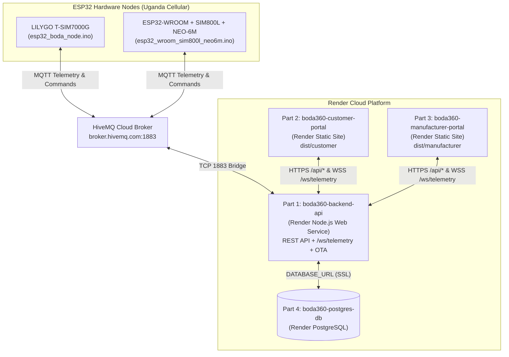

# How to Divide and Deploy Boda 360 on Render

Your **Boda 360** project is structured so you can deploy it on **Render** in **two ways**, depending on whether you want **separated cloud services** (Divided 4-Part Architecture) or a **single unified service** (All-in-One Monolith).

---

## Architecture Overview: How the Project Is Divided

| Part | Folder / Files in Repo | Render Service Type | What It Does |
| :--- | :--- | :--- | :--- |
| **Part 1: Backend API, WebSocket & MQTT Gateway** | [`backend/`](backend/server.js) | **Render Web Service (Node.js)** | Runs `/api/*`, live WebSocket (`/ws/telemetry`), HiveMQ Cellular MQTT Bridge (`broker.hivemq.com:1883`), and Internet OTA Firmware hosting |
| **Part 2: Customer & Public Portal** | [`public/`](public/index.html) + [`customer-portal/`](customer-portal/index.html) | **Render Static Site** *(or served at `/customer`)* | Customer Sign-Up / Login, Post-Signup Bike & IMEI Linking, Live GPS Map, Geofence & Remote Immobilization |
| **Part 3: Manufacturer & OTA Admin Portal** | [`manufacturer-portal/`](manufacturer-portal/index.html) | **Render Static Site** *(or served at `/manufacturer`)* | Hardware Batch Provisioning, Real Deployed Fleet Count, Dual-Board Internet OTA Firmware Server |
| **Part 4: Cloud Database** | [`database/schema.sql`](database/schema.sql) + [`backend/config/db.js`](backend/config/db.js) | **Render PostgreSQL** | Persistent relational database (automatically falls back to JSON-persisted store if omitted) |
| **Part 5: ESP32 Hardware Firmware** *(Not deployed to Render)* | [`firmware/`](firmware/) | **Flashed to ESP32 / Staged via OTA** | Connects over MTN/Airtel Cellular to `broker.hivemq.com:1883` and communicates automatically with your Render Backend |

---

## Way 1: Deploy Divided Services Automatically Using `render.yaml` (1-Click Blueprint)

We have created [`render.yaml`](render.yaml) and [`scripts/prepare-render-static.js`](scripts/prepare-render-static.js) at the root of your project. This divides and deploys all 4 parts automatically:

1. Push your project folder to a **GitHub** or **GitLab** repository.
2. Log in to [https://dashboard.render.com](https://dashboard.render.com).
3. Click **New +** &rarr; **Blueprint**.
4. Connect your GitHub repository. Render will automatically detect [`render.yaml`](render.yaml) and show the **4 divided resources**:
   - `boda360-postgres-db` (PostgreSQL Database)
   - `boda360-backend-api` (Node.js Web Service)
   - `boda360-customer-portal` (Static Site)
   - `boda360-manufacturer-portal` (Static Site)
5. Click **Apply**.
6. *(Optional)* Once `boda360-backend-api` finishes deploying, copy its Render URL (e.g. `https://boda360-backend-api-xxxx.onrender.com`) and verify that `API_BASE_URL` in the two Static Sites matches that exact URL.

---

## Way 2: Manual Step-by-Step Setup on Render (Divided Services)

If you prefer creating each divided service manually in the Render Dashboard instead of using Blueprint:

### Step 1 — Create Part 4: Render PostgreSQL Database *(Optional)*
1. In Render Dashboard, click **New +** &rarr; **PostgreSQL**.
2. **Name:** `boda360-postgres-db`
3. **Database:** `boda_iot_db`
4. **Plan:** `Free`
5. Once created, copy the **Internal Database URL** (starts with `postgresql://...`).

### Step 2 — Create Part 1: Backend API + WebSocket + MQTT Service
1. Click **New +** &rarr; **Web Service** and connect your GitHub repository.
2. Configure the service settings:
   - **Name:** `boda360-backend-api`
   - **Runtime:** `Node`
   - **Build Command:** `npm install`
   - **Start Command:** `npm start`
   - **Health Check Path:** `/healthz`
3. Add **Environment Variables**:
   - `NODE_ENV` = `production`
   - `ENABLE_SIMULATOR` = `false`
   - `MQTT_BROKER_HOST` = `broker.hivemq.com`
   - `MQTT_BROKER_PORT` = `1883`
   - `DATABASE_URL` = *(Paste your Render Internal Database URL from Step 1)*
4. Click **Create Web Service** and copy its public URL (e.g. `https://boda360-backend-api.onrender.com`).

### Step 3 — Create Part 2: Customer Portal (Static Site)
1. Click **New +** &rarr; **Static Site** and connect the same repository.
2. Configure the settings:
   - **Name:** `boda360-customer-portal`
   - **Build Command:** `npm run build:render`
   - **Publish Directory:** `dist/customer`
3. Under **Environment Variables**, add:
   - `API_BASE_URL` = `https://boda360-backend-api.onrender.com` *(your Backend URL from Step 2)*
4. Under **Redirects / Rewrites**, add:
   - **Source:** `/api/*` &rarr; **Destination:** `https://boda360-backend-api.onrender.com/api/*` (**Action:** `Rewrite`)

### Step 4 — Create Part 3: Manufacturer / Admin Portal (Static Site)
1. Click **New +** &rarr; **Static Site** and connect the same repository.
2. Configure the settings:
   - **Name:** `boda360-manufacturer-portal`
   - **Build Command:** `npm run build:render`
   - **Publish Directory:** `dist/manufacturer`
3. Under **Environment Variables**, add:
   - `API_BASE_URL` = `https://boda360-backend-api.onrender.com` *(your Backend URL from Step 2)*
4. Under **Redirects / Rewrites**, add:
   - **Source:** `/api/*` &rarr; **Destination:** `https://boda360-backend-api.onrender.com/api/*` (**Action:** `Rewrite`)

---

## Way 3: All-in-One Single Render Web Service (Simplest Setup)

Because [`backend/server.js`](backend/server.js#L46-L51) already mounts `/customer`, `/manufacturer`, `/api/*`, and `/ws/telemetry` on the same Express + WebSocket server, you can also deploy the **entire platform as a single Render Web Service**:

1. Click **New +** &rarr; **Web Service** on Render and connect your GitHub repo.
2. Set:
   - **Build Command:** `npm install`
   - **Start Command:** `npm start`
3. Once deployed at `https://your-app-name.onrender.com`, all portals work immediately on the same domain with zero cross-domain configuration:
   - **Landing & Customer Sign-Up / Login:** `https://your-app-name.onrender.com/`
   - **Customer Live Tracking Portal:** `https://your-app-name.onrender.com/customer`
   - **Manufacturer & OTA Admin Portal:** `https://your-app-name.onrender.com/manufacturer`
   - **Live WebSocket Telemetry Stream:** `wss://your-app-name.onrender.com/ws/telemetry`
   - **Internet OTA Download Endpoint for ESP32:** `http://your-app-name.onrender.com/api/ota/download/lilygo_tsim7000g`
